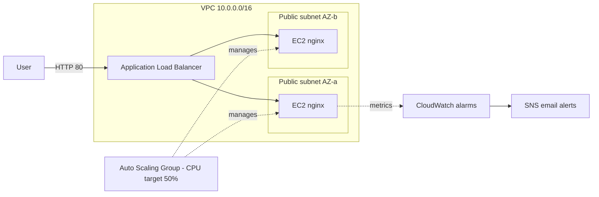

# AWS Web Tier with Terraform

Production-style AWS infrastructure defined entirely in Terraform: a VPC, an
Application Load Balancer, an auto-scaling group of nginx servers, CloudWatch
alarms with SNS alerts, remote state in S3, and a GitHub Actions pipeline that
authenticates to AWS with OIDC (no stored access keys).

## Architecture



## What it demonstrates

- Reusable **modules** (`vpc`, `web`, `monitoring`) consumed by an `environments/dev` root
- **Remote state** in S3 with versioning, encryption and native state locking
- **High availability**: two AZs, ALB health checks, ASG self-healing
- **Security**: instances accept traffic only from the ALB security group, IMDSv2 enforced,
  shell access through SSM Session Manager (no SSH key, no port 22)
- **Observability**: CPU, 5xx and unhealthy-host alarms routed to SNS
- **CI**: fmt, validate and plan on every pull request, OIDC auth to AWS

## Repo layout

```
bootstrap/            one-time S3 bucket for remote state
modules/vpc/          VPC, subnets, internet gateway, routes
modules/web/          ALB, target group, launch template, ASG, IAM, security groups
modules/monitoring/   SNS topic and CloudWatch alarms
environments/dev/     root module wiring everything together
.github/workflows/    CI pipeline
```

## Deploy it

Prerequisites: Terraform >= 1.10, AWS CLI configured (`aws sts get-caller-identity` works).

```bash
# 1. Create the remote state bucket (once)
cd bootstrap
terraform init
terraform apply -var="state_bucket_name=<your-unique-bucket-name>"

# 2. Point the dev environment at that bucket
cd ../environments/dev
# edit backend.tf and set bucket = "<your-unique-bucket-name>"
cp terraform.tfvars.example terraform.tfvars   # set alert_email

# 3. Deploy
terraform init
terraform plan
terraform apply

# 4. Open the app_url output in a browser and refresh to see load balancing
```

## Clean up (important, avoids charges)

```bash
cd environments/dev && terraform destroy
cd ../../bootstrap && terraform destroy -var="state_bucket_name=<name>"
```

The state bucket is versioned, so empty all object versions before destroying it.

## Cost notes

The ALB and EC2 instances are billed while running. Instances sit in public
subnets (restricted by security groups) to avoid NAT gateway charges, which is
a deliberate cost trade-off for a learning project. A production design would
use private subnets with NAT.

## CI/CD setup

1. Create an IAM role trusted by GitHub's OIDC provider for this repo
2. Save its ARN as the repository secret `AWS_ROLE_ARN`
3. Open a pull request: the workflow runs fmt, validate and plan

## What I learned

- Splitting infrastructure into modules and environments
- Bootstrapping remote state safely
- Replacing static AWS keys with OIDC federation
- Designing least-privilege security group chains (ALB to instance)

## Roadmap

- [ ] Private subnets + NAT and an RDS database tier
- [ ] HTTPS with ACM and Route 53
- [ ] Claude-powered terraform plan review in the pipeline
- [ ] Policy checks with tfsec / Checkov
